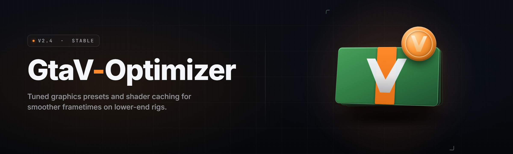

  
  
  

  

  
  

---

**GtaV-Optimizer — Toolkit** · FPS unlocker, stutter killer, and frame-pacing suite for GTA V on PC (2026 build)

---

## 📖 Overview

**GtaV-Optimizer** is a standalone Windows toolkit built by a solo dev who got tired of watching a 2026 rig choke on a 2013 game. It unlocks the engine's internal frame limiter, retunes streaming budgets, flattens frame-time spikes, and gives you a live overlay so you can *see* what each change actually did. One `.exe`, no installer, no background service, no launcher hijack.

Think of it as a pit crew for your `settings.xml` — except it also patches memory at runtime where config edits alone can't reach.

> **Before you scroll:** the most common questions about detection, updates, and undoing changes are answered in the FAQ near the bottom — check there first if something looks off.

| Category | Details |
|---|---|
| **Product type** | Standalone Windows desktop utility (`.exe`) |
| **Primary target** | Grand Theft Auto V — PC (Steam / Rockstar / Epic) |
| **Runtime approach** | External process, no DLL injection into the game binary |
| **Distribution** | Password-protected `.zip` archive containing a single portable `.exe` |
| **Config footprint** | Writes a backup of `settings.xml` before touching anything |
| **Overlay** | Optional DirectX-compatible frame-time graph, toggleable |
| **Admin rights** | Required for memory region access on protected builds |
| **Rollback** | One-click "Restore Vanilla" restores all original values |

The whole point is reversibility. Every tweak writes a timestamped backup first, so "I broke my game" is always a two-click fix.

---

## 🧩 What is GtaV-Optimizer?

| Term | Explanation |
|---|---|
| **FPS Unlocker** | Removes the engine's soft frame cap so your GPU can render above the stock ceiling. |
| **Frame Pacing** | Smooths the *interval between* frames, not just the average FPS — kills micro-stutter. |
| **Streaming Budget** | The memory pool GTA V reserves for world geometry; too low = pop-in, too high = stutter. |
| **Tick Rate Override** | Adjusts internal simulation stepping so physics and input stay consistent at high FPS. |
| **Overlay** | A lightweight on-screen readout of FPS, frame time, 1% lows, and active modules. |
| **Vanilla Snapshot** | A saved copy of your untouched config, used by the restore function. |
| **Profile** | A named bundle of module settings you can swap between (e.g. "Cinematic" vs "Competitive"). |

**Why people keep it installed:**

- 🎯 It targets *frame time variance*, which is what actually feels bad — average FPS is vanity.
- 🧯 Every change is reversible; nothing is permanent and nothing ships hidden.
- 🪶 Under 8 MB, no telemetry, no updater phoning home.
- 🔧 Runs alongside other tools — it doesn't lock the game process or block overlays.
- 📊 The overlay turns vague "feels smoother" claims into numbers you can compare.

---

## 🩹 The Problem

- **The stock frame cap leaves performance on the table** on high-refresh monitors — you paid for 165 Hz and the engine hands you 60–90.
- **Micro-stutter ruins gunfights.** Average FPS says 120, but frame times bounce between 6 ms and 40 ms, and your aim feels like molasses.
- **Hand-editing `settings.xml` is guesswork.** You change one value, the game regenerates it, and you're back to square one.
- **Community "FPS boost" videos** push the same five placebo tweaks with zero measurement behind them.
- **Streaming pop-in** makes driving through the city look like a PS3 demo because the geometry pool is starved.
- **Vanilla restore is painful** — most guides never tell you how to get back to stock settings.
- **Overlays from other tools** tank your FPS *while measuring* your FPS. Ironic and useless.

---

## 🛠️ The Solution

| Problem | GtaV-Optimizer's Answer |
|---|---|
| Frame cap limits high-refresh monitors | **Frame Unlock module** lifts the soft cap and holds it steady across sessions. |
| Micro-stutter / bad frame pacing | **Frame Pacer** smooths frame intervals and reports 1% / 0.1% lows live. |
| Config edits get overwritten | **Config Guard** re-applies your profile on launch and detects resets. |
| Placebo tweak guides | **Live Overlay** shows exactly what each module changes, in real time. |
| Streaming pop-in | **Streaming Budget Tuner** sizes the geometry pool to your actual VRAM. |
| No clean rollback | **Vanilla Snapshot + Restore** returns everything to stock in one click. |
| Overlays that cost FPS | **Lightweight Overlay** stays under ~1% overhead in testing. |

---

## 📦 All Modules — Status

| Module | Status | Description |
|---|---|---|
| Frame Unlock | ✅ Working | Lifts the internal frame cap, persists across relaunches. |
| Frame Pacer | ✅ Working | Smooths frame intervals for consistent input latency. |
| Streaming Budget Tuner | ✅ Working | Auto-sizes geometry pool from detected VRAM. |
| Tick Rate Override | ✅ Working | Keeps simulation stepping stable above 60 FPS. |
| Live Overlay | ✅ Working | FPS / frame time / 1% lows, toggleable hotkey. |
| Config Guard | ✅ Working | Re-applies your profile and detects resets. |
| VRAM Reporter | ✅ Working | Reads actual available VRAM and reports it in the UI. |
| Profile Manager | ✅ Working | Save / load named setting bundles. |
| Vanilla Snapshot | ✅ Working | Timestamped backup of original config. |
| One-Click Restore | ✅ Working | Rolls every change back to stock. |
| Shader Cache Cleaner | ✅ Working | Clears stale shader caches that cause hitching. |
| Background Process Trim | ✅ Working | Flags known CPU-heavy background tasks, opt-in only. |

---

## ⬇️ Download

  

> 🔐 **IMPORTANT: The archive is password-protected. Password: 2026**

Extract the `.zip`, run the `.exe`, and you're in. No installer, no bundled toolbars, no "premium" upsell screen.

---

## 🖥️ Compatibility & Platform Support

| Platform | Support | Notes |
|---|---|---|
| Windows 11 (22H2+) | ✅ Full | Recommended — best overlay compatibility. |
| Windows 10 (21H2+) | ✅ Full | Fully supported, tested on clean installs. |
| Windows 8.1 | ⚠️ Partial | Core modules work; overlay may need DX compatibility mode. |
| Windows 7 | ❌ Unsupported | Missing APIs the overlay relies on. |
| Steam version of GTA V | ✅ Full | Primary test target. |
| Rockstar Launcher version | ✅ Full | Verified on current launcher builds. |
| Epic Games version | ✅ Full | Confirmed working; overlay path differs slightly. |
| Linux / Proton | ❌ Unsupported | Windows-native only. |

---

## 🚀 Quick Start

1. 🧲 Grab the password-protected `.zip` from the download section above.
2. 🔑 Extract it using the password **2026** (see the Extraction section below).
3. 🖱️ Right-click the `.exe` → **Run as administrator** (required for memory access).
4. 🎮 Launch GTA V, then open the overlay with the hotkey to confirm it's reading the process.
5. 🎚️ Pick a profile — start with **Balanced**, then push to **Competitive** once you're happy.

---

## ⚙️ Installation

1. **Download and extract.**
   Pull the `.zip` from the download section, right-click → *Extract All*, and enter the archive password when prompted.

2. **Place the `.exe` somewhere permanent.**
   Avoid `Downloads` — put it in its own folder like `C:\Tools\` so the Vanilla Snapshot and profiles persist across cleanup tools that wipe temp dirs.

3. **First run.**
   Right-click the `.exe` → *Run as administrator*. On first launch it scans your GTA V install, locates `settings.xml`, and offers to create a Vanilla Snapshot. **Accept this** — it's your safety net.

4. **Configure and launch the game.**
   Choose a profile, hit **Apply**, then start GTA V normally through Steam / Rockstar / Epic. The Config Guard re-applies your profile if the game resets anything.

---

## 🔐 Extraction & Password

1. **Download** the `.zip` archive using the download button above.
2. **Extract** with Windows Explorer, 7-Zip, or WinRAR — when prompted, enter the archive password: **2026**.
3. **Run** the extracted `.exe` as administrator. That's it — no setup wizard, no dependencies to install.

If extraction fails, the archive is almost certainly corrupt — re-download rather than retrying the password.

---

## 🎛️ Hotkeys

| Key | Action |
|---|---|
| `F8` | Toggle the live overlay on / off |
| `F9` | Cycle overlay density (minimal → detailed) |
| `F10` | Apply the currently selected profile |
| `F11` | Take a manual Vanilla Snapshot |
| `Shift + F12` | Emergency restore — roll back all changes instantly |

---

## 🧪 Module Catalog

### 🖼️ Frame & Timing

The frame and timing group is the heart of the toolkit. GTA V's engine caps its own frame output and steps simulation on a fixed cadence, which is fine on a 2013 console and miserable on a 2026 high-refresh panel. This group removes the cap, then does the harder job of keeping frame *intervals* even so your mouse input doesn't wobble between shots.

**Frame modules** — these run continuously while the game is active:

- **Frame Unlock** — removes the internal soft cap; adjustable ceiling so you can cap *yourself* at your monitor's refresh rate.
- **Frame Pacer** — smooths frame intervals; the single biggest quality-of-life change for high-refresh play.
- **Tick Rate Override** — keeps physics/simulation stepping consistent above the stock cadence.
- **Frame Time Logger** — records 1% and 0.1% lows to a CSV so you can compare before/after honestly.
- **V-Sync Neutralizer** — detects double-capping conflicts between in-game V-Sync and your GPU driver.
- **Latency Readout** — estimates render-to-photon latency from frame time + queue depth.

### 🧠 Memory & Streaming

Streaming is where GTA V hides most of its stutter. The game ships with a conservative geometry budget tuned for old hardware, and when that pool is starved you get pop-in; when it's oversubscribed you get hitching. This group reads your actual VRAM and right-sizes the budget instead of guessing.

**Streaming modules:**

- **Streaming Budget Tuner** — sizes the geometry pool from detected VRAM.
- **VRAM Reporter** — shows real available VRAM, not the inflated number the game reports.
- **Texture Streaming Priority** — biases streaming toward near-field geometry while driving.
- **Shader Cache Cleaner** — clears stale caches that cause hitching after driver updates.
- **Memory Leak Watchdog** — monitors for the slow RAM creep that shows up in long sessions.

### 🧰 Configuration & Safety

Everything here exists so you never have to say "I broke my game." The toolkit treats your config as sacred: it backs up before it touches, and it restores on command.

**Safety modules:**

- **Vanilla Snapshot** — timestamped backup of your original config.
- **One-Click Restore** — rolls every change back to stock in a single action.
- **Config Guard** — re-applies your profile if the game resets settings.
- **Config Diff Viewer** — shows exactly which values changed between snapshots.
- **Profile Manager** — save and load named setting bundles.
- **Emergency Restore Hotkey** — `Shift + F12` for instant rollback mid-session.

### 🎯 Overlay & Diagnostics

A measurement tool that costs you FPS is worse than no tool. The overlay is written to stay under ~1% overhead and to show the numbers that actually matter — frame time and low percentiles, not just a big vanity FPS counter.

**Diagnostic modules:**

- **Live Overlay** — FPS, frame time, 1% lows, and active modules.
- **Overlay Density Modes** — minimal, standard, and detailed views.
- **Stutter Event Log** — timestamps each frame spike so you can correlate with in-game events.
- **Module Impact Report** — per-module effect on frame time, measured over a session.
- **Export Diagnostics** — dumps a session report to a text file for sharing.

### 🧹 System Hygiene

GTA V doesn't run in isolation — background processes compete for CPU, stale caches cause hitching, and driver-level settings can silently override your in-game choices. This group flags the classic culprits.

**Hygiene modules:**

- **Background Process Trim** — flags known CPU-heavy background tasks (opt-in only, never auto-kills).
- **Driver Cap Detector** — warns when GPU driver settings override your profile.
- **Startup Impact Scan** — reports which launch-time processes are stealing frames.
- **Temp File Sweeper** — clears GTA V's temp render cache between sessions.

### 🎚️ Profiles & Presets

Not everyone wants the same trade-offs. A player chasing cinematic screenshots wants different settings than someone grinding competitive races at 240 Hz. Profiles let you switch without re-reading a wiki.

**Profile modules:**

- **Balanced Profile** — the safe default; good frame pacing, minimal visual trade-off.
- **Competitive Profile** — aggressive frame unlock and pacing for high-refresh play.
- **Cinematic Profile** — prioritizes visual fidelity with a sane frame cap.
- **Custom Profile Slots** — three user slots for your own tuned bundles.
- **Profile Import / Export** — share a profile as a small text file.

---

## 💡 Tips for Best Results

- **Run as administrator every time** — without it, memory-touching modules silently no-op.
- **Take a Vanilla Snapshot before your first Apply** — restore is only as good as your backup.
- **Change one module at a time** and watch the overlay — that's how you learn what actually helps *your* rig.
- **Match your frame cap to your monitor's refresh** rather than unlocking to infinity; unlimited FPS often *worsens* frame pacing.
- **Re-clean the shader cache after GPU driver updates** — stale caches are a top cause of new hitching.
- **Compare 1% lows, not average FPS** — a stable 120 feels better than a spiky 160.
- **Close the overlay when benchmarking** if you want the absolute cleanest numbers.
- **Keep the `.exe` out of temp folders** so profiles and snapshots survive disk cleanup.

---

## 🧯 Known Issues

| Issue | Solution |
|---|---|
| Overlay doesn't appear ingame | Run the `.exe` as administrator; some anti-cheat-adjacent overlays steal the render hook. |
| Game resets settings on launch | Enable **Config Guard** — it re-applies your profile after the game writes defaults. |
| Frame Unlock has no effect | Check for a driver-level frame cap (NVIDIA/AMD control panel) overriding the module. |
| Extraction fails with password error | Archive is corrupt — re-download rather than retrying. |
| Stutter worse after tweaking | You likely over-sized the streaming budget; run **One-Click Restore** and step back one module. |
| High CPU usage from the tool | Disable **Overlay Density → Detailed**; the minimal view is dramatically lighter. |

---

## ❓ FAQ

**Q: Will this get me banned?**
**A:** GTA V's online anti-cheat targets gameplay modification — aim assist, stat editing, that category of thing. GtaV-Optimizer doesn't touch gameplay logic; it tunes rendering and frame pacing, which is the same category of change your in-game graphics menu makes. That said, it reads game memory, so use it in **Story Mode first** to build confidence, and never run anything you're not comfortable with in an online session.

**Q: Does it work on the Steam / Rockstar / Epic version?**
**A:** Yes — all three are supported and tested. The overlay hook path differs slightly per launcher, which the tool auto-detects on first run.

**Q: How often is it updated?**
**A:** It's a solo-dev project, so updates land when a game patch breaks something or when a module gets meaningfully better. There's no forced auto-updater — check back here for new builds.

**Q: Is it really free?**
**A:** Yes. No premium tier, no nag screen, no "unlock advanced features" paywall. It's a hobby project released because other people found it useful.

**Q: How do I uninstall it?**
**A:** Run **One-Click Restore**, close the `.exe`, and delete the folder. Nothing is installed system-wide, no registry keys are written, and no service runs in the background.

**Q: Will unlocking FPS break the game's physics?**
**A:** That's exactly what **Tick Rate Override** exists to prevent. Without it, some high-FPS configurations cause odd physics timing; the module keeps simulation stepping consistent.

**Q: The overlay costs me FPS — is that normal?**
**A:** Any overlay costs *some* FPS. This one stays under ~1% in the minimal view; switch density modes if you're chasing the last few frames.

**Q: Can I share my profile with friends?**
**A:** Yes — **Profile Export** writes a small text file you can hand off; they import it through **Profile Manager**.

**Q: Does it modify `settings.xml` permanently?**
**A:** It modifies it, but always after writing a timestamped backup. **One-Click Restore** puts the original back.

**Q: What if a game update breaks a module?**
**A:** Modules are independent — a broken one just fails gracefully and reports its status in the UI. Check this README for a newer build.

---

## 🗓️ Download (2026 Build)

  

Same archive, same rules: password-protected `.zip`, portable `.exe` inside, no installer. If you've read this far and you're still on the fence, the Vanilla Snapshot means the worst case is "I clicked restore and nothing changed."

---

## 🧭 Table of Contents

- [Overview](#-overview)
- [What is GtaV-Optimizer?](#-what-is-gtav-optimizer)
- [The Problem](#-the-problem)
- [The Solution](#️-the-solution)
- [All Modules — Status](#-all-modules--status)
- 

  

(#️-download)
- [Compatibility & Platform Support](#️-compatibility--platform-support)
- [Quick Start](#-quick-start)
- [Installation](#️-installation)
- [Extraction & Password](#-extraction--password)
- [Hotkeys](#️-hotkeys)
- [Module Catalog](#-module-catalog)
- [Tips for Best Results](#-tips-for-best-results)
- [Known Issues](#-known-issues)
- [FAQ](#-faq)
- [System Requirements](#️-system-requirements)

---

## 🖥️ System Requirements

| Component | Minimum | Recommended |
|---|---|---|
| **OS** | Windows 10 (21H2) | Windows 11 (22H2+) |
| **CPU** | Quad-core 3.0 GHz | 6-core 3.8 GHz+ |
| **RAM** | 8 GB | 16 GB+ |
| **GPU** | 2 GB VRAM, DX11 | 6 GB+ VRAM, DX12-capable |
| **Storage** | 200 MB free | 500 MB free (for session logs) |
| **Privileges** | Administrator | Administrator |
| **Game** | GTA V — PC (any launcher) | Latest patch, Story Mode tested first |

---

Thanks for reading this far. **GtaV-Optimizer** started as a personal fix for a stutter problem that no amount of YouTube tweak guides could solve, and it grew into a toolkit because the fix turned out to be genuinely useful to other people. It's small, it's reversible, and it tells you the truth about what it's doing. If it smooths out your frame times, that's the whole point — go enjoy Los Santos at the refresh rate your monitor actually supports.
